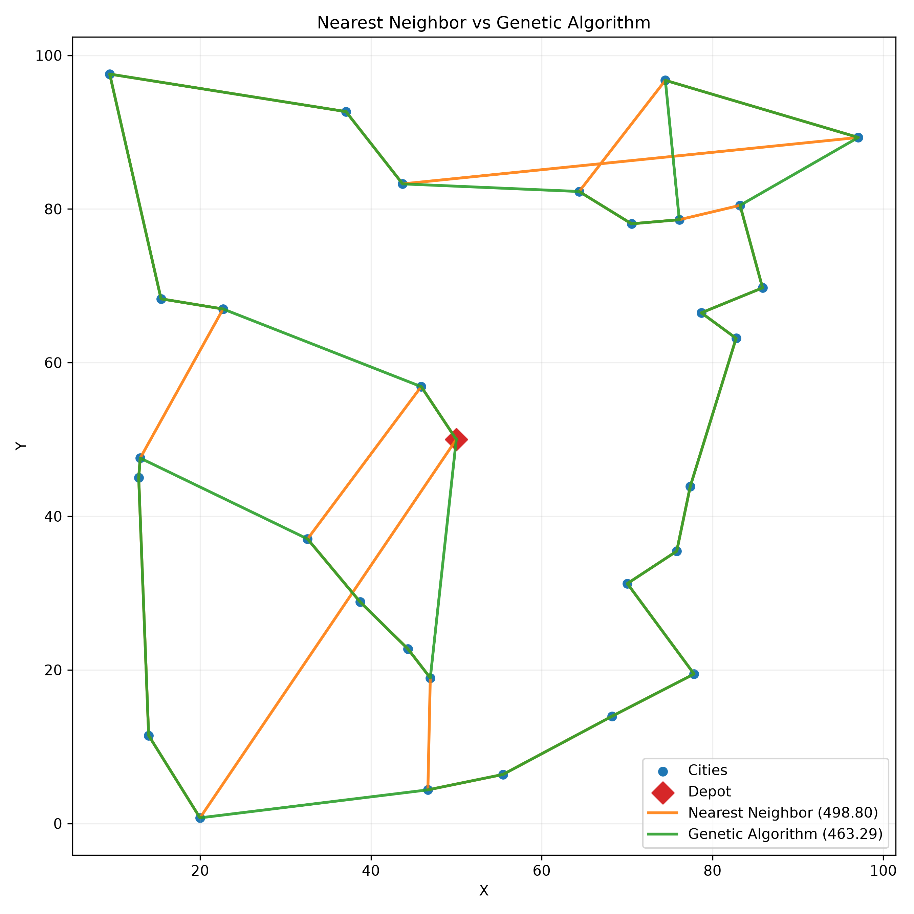
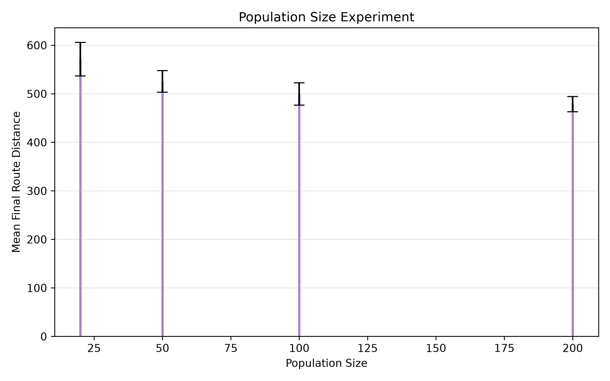
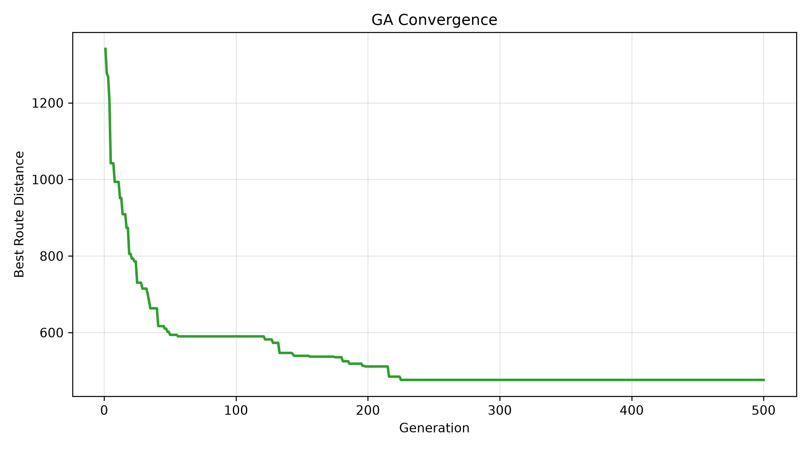

# Optimizing Delivery Routes Using Genetic Algorithms

## Overview

This project implements a small, reproducible Travelling Salesman Problem (TSP) study using a genetic algorithm and a simple nearest-neighbor baseline. The goal is to explore how a genetic algorithm can search for shorter delivery routes on synthetic 2D instances without relying on external optimization libraries or production logistics infrastructure.

The project is intentionally compact and research-oriented: it focuses on methodology, reproducibility, experimental design, and clear reporting rather than building a deployment-ready logistics system.

## Research Basis

This work utilizes the paper:

"Optimizing Delivery Routes Using Genetic Algorithms: A TSP-Based Approach."

This repository does not claim to reproduce the paper's exact experiments or datasets. Instead, it independently implements the core ideas described in that methodology:

- TSP route representation
- Euclidean travel cost
- population-based search
- tournament selection
- order crossover (OX)
- swap mutation
- elitism


## Problem Formulation

A delivery route is treated as a TSP instance with:

- one depot
- a set of delivery locations represented by 2D coordinates
- a route that starts at the depot, visits each delivery city exactly once, and returns to the depot

The objective is to minimize total route length:

- distance = Euclidean distance between consecutive points
- lower total route length = better route

The route is encoded as a permutation of city indices. The depot is not stored inside the chromosome because it is always the start and end point of the tour.

## Genetic Algorithm

The implementation follows the methodology described in the project brief:

- Population: a configurable number of random valid city permutations
- Chromosome: a permutation of city indices
- Fitness: total length of the route from depot to all cities and back
- Selection: tournament selection with a configurable tournament size
- Crossover: Order Crossover (OX) to preserve permutation validity
- Mutation: swap mutation with a configurable mutation probability
- Elitism: preserve the best individuals in each generation

The algorithm evolves a population for a fixed number of generations and returns the best route found.

## Experimental Design

The repository uses synthetic random 2D instances generated in a bounded coordinate space. The main experiment uses 30 cities and a fixed depot at (50, 50).

Key design choices:

- 30-city synthetic instance
- 20 independent GA trials for the GA-vs-nearest-neighbor comparison
- population size sensitivity study at 20, 50, 100, and 200
- fixed random seeds for reproducibility
- route-distance statistics including mean, standard deviation, and best value

The results are saved to the `results/` directory as CSV tables and PNG figures.

## Results

The project was run with the included script and generated the current results shown below.

### GA vs. Nearest Neighbor

| Method | Mean Distance | Std Dev | Best Distance |
|---|---:|---:|---:|
| Nearest Neighbor | 498.804461 | 0.000000 | 498.804461 |
| Genetic Algorithm | 499.362519 | 23.051994 | 463.289437 |

Relative to the chosen nearest-neighbor baseline on this synthetic 30-city instance:

- GA mean distance = 499.36
- nearest-neighbor distance = 498.80
- improvement relative to the baseline = -0.11%

This is a valid experimental finding: the GA was not superior on this particular instance when using the reported mean over 20 independent GA runs.



### Population Size Experiment

| Population Size | Mean Distance | Std Dev | Best Distance |
|---|---:|---:|---:|
| 20 | 571.267146 | 34.650637 | 509.407109 |
| 50 | 525.477076 | 22.037011 | 488.225057 |
| 100 | 499.362519 | 23.051994 | 463.289437 |
| 200 | 478.631199 | 15.605974 | 463.289437 |

The trend suggests that larger populations can improve the average final route quality on this synthetic task, although the relationship is not strictly monotonic in all runs.



### Convergence Analysis

The genetic algorithm tracks the best route distance at each generation for a representative run.



## Discussion

Several observations are consistent with the experiment data:

- On this specific synthetic 30-city instance, the nearest-neighbor heuristic performed slightly better than the GA mean under the chosen configuration.
- The best GA run reached a much shorter route than the baseline, showing that the algorithm can still find strong tours even when the mean result is not consistently better.
- Larger populations tended to yield lower average route distances, which is consistent with the idea that more diverse search can help the GA avoid premature convergence.
- The variation across runs shows that seed choice matters, especially for stochastic heuristics.

These results should be interpreted carefully: they are specific to the synthetic instance and the chosen algorithm configuration, not universal claims about GA performance in all delivery settings.

## Limitations

This project uses a simplified TSP formulation and therefore does not model several real-world routing constraints, including:

- Euclidean distance rather than road-network distance
- a single vehicle only
- no capacity constraints
- no time windows
- static locations without traffic or delays
- no route constraints created by road geometry or regulations

## Future Work

Possible extensions include:

- capacitated vehicle routing
- multiple vehicles
- time windows and service deadlines
- real road-network data
- traffic-aware factors
- multi-objective optimization (distance, time, reliability)

## Reproducibility

To install and run the project locally:

```bash
git clone <repository-url>
cd delivery-route-ga
pip install -r requirements.txt
python main.py
```

This command regenerates the CSV result files and the PNG plots in `results/`.

The project is implemented in plain Python with NumPy and Matplotlib and does not depend on external APIs or databases.
